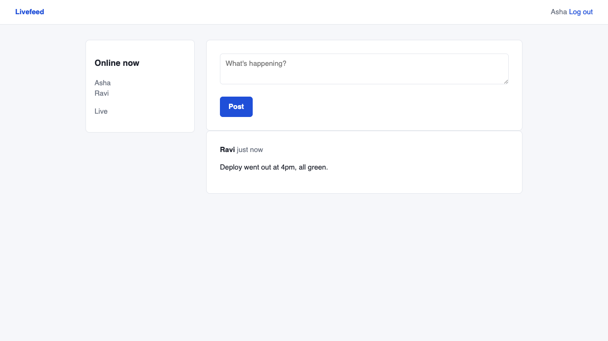

# Livefeed

A small realtime team feed built with Laravel 12 and Reverb (Laravel's own WebSocket server). People log in, post short updates, and every open browser shows new posts instantly, with a live "Online now" list. No page reloads, no polling.



## What it shows

- Broadcasting an event (`PostCreated`) over Reverb when a post is saved
- A presence channel, so the page knows who is online (join / leave)
- Channel authorization: only logged-in users can join the feed channel
- Broadcasts sent through the queue, so posting stays fast
- Laravel Echo in the browser, vendored in `public/js` (no Node build step)

## Run it

```
composer install
cp .env.example .env && php artisan key:generate
touch database/database.sqlite
php artisan migrate --seed
```

Then start three processes (three terminals):

```
php artisan serve --port=8095
php artisan reverb:start
php artisan queue:work
```

Open http://localhost:8095 in two different browsers (or one normal and one private window) and log in as `asha@example.com` and `ravi@example.com`, password `password`. Post in one and watch the other.

Reverb listens on port 8086 (`REVERB_SERVER_PORT` in `.env`). Change it there if the port is taken.

## Tests

```
php artisan test
```

Six feature tests: login rules, saving and validating posts, the event going out on the `presence-feed` channel with the right payload, newest-first ordering, and channel auth (guests refused, users get their info back).

See [docs/HOW-IT-WORKS.md](docs/HOW-IT-WORKS.md) for a walkthrough and likely interview questions.
